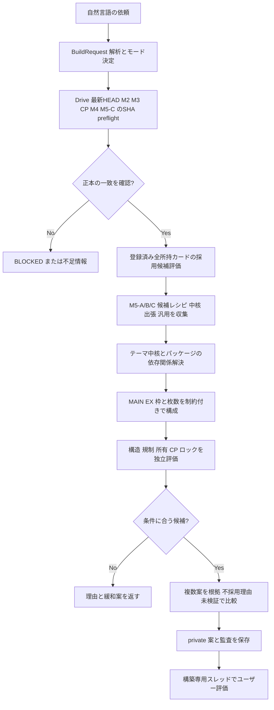

> **2026-11-11 M6-5完了（最新進捗）**：候補比較・全所持カードの採否理由・EX不足と出典付き補強候補・不変private proposal ZIP/manifestを実装。軍貫EX7は不足8枠を最適化済みとみなさない。元掲載版との差8枚のうちUR7枚/SR1枚で、唯一のSR候補は必要な別MAIN/EXパーツの裏取り未完により保留。private 135種類全件の選定理由を記録・SHA再取得完了、実コードでの生データ一気通貫受入はM6-6。M6-7は未着手。[M6-5監査](M6_5_COMPARISON_PRIVATE_PROPOSAL_AUDIT_20261111.md)。当初設計本文は履歴。

> **2026-11-11 M6-4完了（現時点の最新進捗）**：`engine_m6/evaluate.py`で源泉SQLite/CP SHAをピンし、所有UNKNOWNの生成枚数・CP下限/上限、CORE_UR_ZERO/NEW_UR_CRAFT_ZERO/STRICT_NO_UR、M3候補と正式MD規制を分離。軍貫の掲載MAIN40/EX15・UR20例と低レアMAIN40/EX7・UR0案を独立privateソース再評価。EX7は未使用8枠・最適性未検証として残し、M6-5で補強候補を比較する。M6-5〜M6-7は未着手。[M6-4監査](M6_4_COST_REGULATION_EVALUATION_AUDIT_20261111.md)。以下の設計本文は当初の履歴として保持。

> **2026-11-11 M6-3進捗**：`engine_m6/assemble.py`を実装し、出典付き記事レシピとC3低レア仮説の2系統から構造候補を生成。個別カードの採用理由/出典、MAIN/EX/3枚制約、欠損元記事、明示編集と元記事の区別、STALE、探索上限を検証。private独立ソース照合では軍貫2案構造PASS、イビルツインの記事39/40をBLOCKED。実コードのprivateデータ統合受入はM6-6で実施。禁止制限・所持・CP・必須コア確定はM6-4以降。[監査](M6_3_ASSEMBLY_AUDIT_20261111.md)。下記初期計画の記録は履歴。

> **2026-11-11 M6-2受入（最新）**：候補プール、出張依存・代替/ロック・M5-A/B旧索引取込を実装し合成試験。C5実データの5テーマをprivate別監査。旧M5-A/B索引はGen3ソースのため現行Gen5と異なり`STALE_SOURCE_GENERATION`、最新MDのサポート成立/規制適合とはしない。C5の確定COREパッケージは現状0件。M6-3〜M6-7は未着手。[M6-2監査](M6_2_CANDIDATE_POOL_AUDIT_20261111.md)。後述の当初設計時点の「未着手」は歴史記録。

> **2026-11-11 M6-1実装（最新進捗）**：`engine_m6/preflight.py`にSHAピンのHEAD二度読み・ZIP/SQLiteの整合・所持登録135件の全行チェック・M3/CP/C5 sidecar入力ゲートを追加。private現行Generation5ではSHA/整合一致、登録135（KNOWN_POSITIVE66/KNOWN_ZERO69）、規制候補215をread-only監査。**全件取得PASSだが、デッキ別採否135件はREVIEW_REQUIREDでPARTIAL**。M3候補禁止0は採用保留、現行合法性は未検証。M4/M5-A/B追加索引のraw SHA・候補生成はM6-2以降。[M6-1監査](M6_1_READONLY_PREFLIGHT_AUDIT_20261111.md)。以下の初期基本設計は履歴として保持する。

> **2026-11-11 M6-0完了（進捗追補）**：`engine_m6/schema.py`・`inputs.py`の構築依頼/正本pins/登録済み所持全件監査/候補/評価契約を実装。合成テストを全体回帰に追加し、UNKNOWNと0、異世代、未検証推薦、採用理由漏れを拒否。実private HEAD読出し・レシピ生成（M6-1以降）は未着手。[M6-0監査](M6_0_CONTRACT_AUDIT_20261111.md)。下記「実装未着手」は当初設計時点の履歴です。

# M6 基本設計 — 所持・規制・CPを考慮した低レアデッキ候補生成（2026-11-11）

- 状態: **設計確定候補・実装未着手**。本書の追加はM6の動作開始を意味しない。
- 対象: 個人向け遊戯王マスターデュエル（MD）。デッキ構築専用スレッドは受入・普段使い、開発はGitHub/開発スレッド。
- 正本: [基本設計](BASIC_DESIGN.md)、[デッキ構築Preflight運用](DECK_BUILD_STANDARD_WORKFLOW_20261110.md)、[残工程](INITIAL_GOAL_REMAINING_ROADMAP_20261110.md)、[M5-C C5受入](M5C_C5_PRIVATE_BUNDLE_M6_AUDIT_20261111.md)。本書で旧文書の不変条件を緩和しない。

## 1. 目的と完了条件

### 目的
1. リクエストからMD構築条件（テーマ、メイン/EX枠、モード、所持利用、生成CP、出張、先攻/後攻、比較対象）を構造化する。
2. **毎回最新のprivate HEAD/所持全件**と、M3日付つき禁止制限、M4本文根拠、M5-A/B/C知識を独立にSHA検証して結合する。
3. 既知の出典付きレシピ/中核/出張/汎用候補を起点に、**少なくともMAIN40～60、EX0～15**の複数候補を構成し、構造整合、UR条件、採用枠、既知制約、所持、CPを検査する。
4. 「採用理由・採用しなかった所持カード全件・欠けている中核・失った展開・新規生成・不確実性」を再現可能な監査として保存する。
5. 検証の及ばないルール・現行規制・生成可否・所持を**PASSと推定しない**。合法性未確定でも、使用可能性のある暫定候補として別表示できる。

### 明確な非目的
- ゲーム内の完全裁定・チェーン処理の自動証明、勝率・環境Tierの保証、ゲーム画面への自動ログイン、パック解放ナビ完成（M7）、すべての自然言語UXと全件自動更新（M8）。
- M5-CのSOURCE_OBSERVEDをゲーム内検証済みへ自動昇格すること。
- M3の215件の`UNVERIFIED_SOURCE`規制候補を確定版へ昇格すること。
- 知識不足のテーマに対して根拠のない40枚を捏造すること。

## 2. 現在地（実装開始時に必ず再取得）

| データ | 2026-11-11の到達点 | M6での扱い |
|---|---|---|
| M1/本番MDカードSQLite | HEAD Generation5、13,948種類、日本語名/効果/MDレア | **参照のたび最新HEADをフォルダから発見**。Gen5の固定運用は禁止 |
| M2/汎用所持台帳 | 登録135種類、未登録はUNKNOWN（所持データは更新され得る） | 最新HEADを検証後、**登録済み全件**をpreflightする |
| M2-D/登録済みデッキ | 別系統catalog Generation2、イビルツイン・スプライトv1確認 | 自分のデッキ指定時は最新CONFIRMED snapshotを別検索。採用枚数は所持枚数でない |
| M3 | 2026-11-05版215規制候補は`UNVERIFIED_SOURCE`、レア毎30CP方針は`USER_CONFIRMED` | 規制候補の警告/暫定判定と公式確認済みを分離。生成可否UNKNOWNは`PROVISIONAL_GO`で候補調査可、確定禁止 |
| M4 | 日本語本文にひもづく効果ファセット候補と一部原文アンカー | 発動条件/ロック/対象を原文へ戻り検査。裁定保証しない |
| M5-A/B | 3出張系統、汎用/テーマ関連の幅広い候補 | 候補素材。名称候補≠正式テーマ、属性/種族一致≠利用可能 |
| M5-C | C0〜C5完了、private ZIP/manifest→`ThemeKnowledgeBundle` | ZIP/manifest/元DB **外部期待SHAを入力**して検証。全bundle`recommendation_eligible=false`は初期値 |

**重要**: 本設計はM5-C側の材料をM6が個別再検証して候補に変える契約である。「M6へBundleを返せる」ことを「M6が完成構築を生成できる」と扱わない。

## 3. モードとゲートの厳格な区別

### 3.1 指示の解釈
`LOW_RARITY_CORE`を既定：**必須のテーマ中核UR0、新規生成UR0**。所持確認済みの汎用・出張URは必要に応じて採用可。会話上の「UR0」「URなし」も、特に所持分まで禁止と指定しない限り、この既定を採用する。

| mode | 主な条件 |
|---|---|
| `STRICT_NO_UR` | MAIN/EXの**採用UR合計0**。所持URも不可 |
| `LOW_RARITY_CORE`（既定） | 必須中核UR0、汎用/出張URは**確認済み所持内**、新規UR生成0 |
| `OWNED_UR_ONLY` | 中核も汎用も所持確認済みURのみ。中核UR0までは要求しない |
| `UR_BUDGET` | 新規UR生成枚数・CPの指定上限。所持UNKNOWNのため判定不能ならPASS不可 |
| `CP_BUDGET` | N/R/SR/URの**通貨別**CP上限。単一合計CPで通貨横断補填しない |

補助制約：`sr_new_copies_max`、`sr_cp_max`、`ur_new_copies_max`、主軸/出張/禁止条件、レシピ枚数、環境・先後希望等。優先順位はユーザー明示条件 > 安全ゲート > 既定条件。曖昧な所持を`KNOWN_ZERO`へ変換しない。

### 3.2 三種類の独立判定
- `CORE_UR_ZERO`: 最小成立セットの**必須テーマ中核**にURがないか。`CORE_UNKNOWN`/`CORE_REMOVED`ならPASS不可。テーマ所属名だけで判断せず、必須EX、始動、到達点を含む。
- `NEW_UR_CRAFT_ZERO`: 候補の必要UR枚数と**実所持の確認数**から不足0を算定できたか。UNKNOWNが混ざれば`INDETERMINATE`。採用UR0なら所持が不明でも構成上0でPASS可。
- `STRICT_NO_UR`: 全カードUR0。URが1枚でも採用されればFAIL。

上記は独立フィールドとして永続化。 `USER_CONFIRMED` CP単価と残高不明も別フィールドに保持する。

### 3.3 判定状態（混同禁止）
- 機械的構造：`PASS / FAIL / INDETERMINATE`。
- MD規制：`GAME_VERIFIED / UNVERIFIED_SOURCE / UNKNOWN / STALE`。0枚の未検証候補は**警告・採用保留**とし、勝手に正式合法PASSにしない。ゲーム内確認後のみ該当個票を昇格する。
- 生成可否：`YES / NO / UNKNOWN`。明示NOかつ追加必要ならHOLD、UNKNOWNは`PROVISIONAL_GO`、**公式生成可能と断言しない**。
- 展開・中核：`HYPOTHESIS / TEXT_CHECKED / REVIEWED / GAME_TESTED`。記事と本文が一致しても`GAME_TESTED`ではない。
- 総合：`STRUCTURAL_CANDIDATE`（構造のみ）、`PROVISIONAL_RECOMMENDATION`（主要違反なし/未検証あり）、`BLOCKED`（明確な条件違反や欠損）、`VERIFIED_RECOMMENDATION`（必要な現行規制・所持・生成費などの一次確認完了時のみ）。現在のデータのみで最後の状態へ自動到達させない。

## 4. 入力・出力契約（概念、Python/JSON実装時にschema固定）

### 4.1 `BuildRequest`
- `request_id`、`as_of`（MD適用日、timezone付き）、`theme_query`/複数候補、`use_registered_deck`、`owned_deck_id`（任意）、`mode`、`strategy`、`constraints`（MAIN/EX、カード/パッケージの必須/除外、汎用/出張可否、各レアCP/枚数予算）、`max_variants`、`compare_goal`。
- 自然言語の抽出結果には`explicit`/ `defaulted`と、曖昧な条件を付与。明示的な「完全UR0」を既定モードで上書きしない。
- 候補の自動発見は`theme_query=null`を許容。ただしM5に材料がない場合は`NEEDS_SOURCE_RESEARCH`で止め、テーマ名/必要札を推測して埋めない。

### 4.2 `SourcePins` — 先行ゲート
- `head_generation`, `head_raw_sha`, `sqlite_zip_sha`, `sqlite_sha`, `inventory_snapshot/as_of`, `m3_snapshot/effective_on/verification`, `cp_policy_sha/effective_on/verification`, `m4_index_sha`, `m5_a_sha`, `m5_b_sha`, `m5_c_zip_sha`, `m5_c_manifest_sha`, `owned_deck_catalog_sha`（必要時）、`readback_at`。
- 取得不能は`null + missing_reason`。**SHA一致しない／HEADとZIPが結び付かない／古いHEADでの混用はBLOCKED**。M5-Cは`open_sidecar`で外部期待SHA、M2-Dは索引→CONFIRMED snapshotを独立取得。
- 所持と禁止制限・CPは**同じHEAD基準／明示的に指定した日付**で評価。別世代混入禁止。

### 4.3 `PreflightAudit` — 全所持監査
- HEADから`inventory`の**登録済み全種類**を取得し、`card_id, known_state, owned_count, rarity, regulation, candidate_role, disposition, reason, selected_quantity`を各1行。
- `disposition = ADOPT / CONSIDER / EXCLUDE / REVIEW_REQUIRED`。未採用カードでも理由を残す。`UNKNOWN`は未入力カードを推測で補うのではなく、候補に採用した時点で参照・表示する。
- `inventory_total_registered`、`inventory_rows_reviewed`、一意カードID、検証HEAD、0/不明の区別。件数不一致なら`preflight_status=BLOCKED`。「全件監査済み」と言えない。
- 現HEADに所持135種類が登録されていた履歴は**合成テストの固定閾値にしない**。毎回現行HEADから件数を計算する。

### 4.4 `DeckCandidate`
`candidate_id`, `theme/variant`, `source_kind`（REGISTERED_OWNED_DECK / ARTICLE_RECIPE / M5C_VARIANT / ASSEMBLED / HUMAN_EDITED）, `lineage`, `sections.MAIN/EX`（card_id、採用数、role、essentiality、出典/効果SHA）、`package_dependencies`, `normal_summon/extra_summon_locks`, `required_core_ids`, `route_ids`, `reasons_by_card`, `reasons_by_omitted_owned_card`, `m5_status`。
- すべての合計は**同じcard_idをテーマ・汎用・出張から多重採用しない**。MAIN/EXの所属不正・複数パッケージの要求合計超過・EX15超過はFAIL。
- 既存ユーザーデッキは編集元として使用可。ただし`CONFIRMED`は文字起こし確認であり、所持枚数・規制の認証ではない。
- 出典レシピに欠損（イビルツイン39/40）がある場合は`INCOMPLETE_SOURCE`。不足1枚を暗黙に補わない。**別名のASSEMBLED構築として補完する際はカードごとの根拠・差分を全表示**。

### 4.5 `DeckEvaluation / ProposalReport`
- `structure`、`mode_gates`（CORE_UR_ZERO, NEW_UR_CRAFT_ZERO, STRICT_NO_UR）、`banlist_per_card`、`craftability_per_card`、`owned_and_new_needed`、`cp_by_rarity`（確定/下限/上限不明）、`m5_confidence`、`route_preconditions`、`source_pins`、`unknowns`、`blocking_reasons`、`preflight_audit_ref`、`proposal_status`、`compared_to`、`explanation`。
- **禁止0候補は実用候補から保留**。未検証規制によって候補全体を`VERIFIED_RECOMMENDATION`にできないことも記載。
- 新規UR0の確定に必要な所有カードがUNKNOWNなら`INDETERMINATE`、補充CPを0と表示しない。
- 出力は`DRAFT`、`PROVISIONAL`、`BLOCKED`等の状態・参照日とともに保持。別スレッドでも正本を再取得すれば再現可能な構造化監査とする。

## 5. パイプライン・依存順序

1. **Read-only preflight**: HEAD/ZIP/SQLiteの正本SHA、所持全件、M3日付版、CP、M4/M5各索引の取得状態。所持・規制・知識のいずれかが変われば評価結果を再利用せず更新を要求。
2. **Candidate retrieval**: M5-C側の`recommendation_eligible=false`は「未検証素材」の警告であり、全件拒否ではない。M6が独立評価した結果だけを推薦段階へ引き上げる。`STALE`/矛盾/未解決カードIDを元から検証済みとして採用しない。
3. **Core extraction and constraint formulation**: 同名カード、必須1枚初動/中継/到達EX、出張MAIN/EX枠、墓地素材・属性ロック・通常召喚権、カード上限をグラフ化。C1掲載レシピの必須/任意がUNKNOWNなら**必須中核UR0を確定しない**。
4. **Variant assembly**: A=元掲載レシピの監査版、B=条件付き低コスト案、C=所持カード流用案。候補の上限`max_variants`/探索打切り条件を設定し、結果が0なら根拠付き`NO_FEASIBLE_CANDIDATE`または`INSUFFICIENT_EVIDENCE`。推測で枠埋めしない。
5. **Evaluation**: 既存`deck_assistant.cost.assess_deck`と`regulation_m3`系の出力を合流。必要に応じアダプタを追加し、従来の`INDETERMINATE`を勝手にPASSへ変えない。候補規制0の警告、現行施行日、公式検証ランクを保持。
6. **Explanation and persistence**: 本番HEADとは別にprivate提案snapshotと検証レポートを不変保存。入力のソースpins/採用理由/見送った所持カード全件/失った展開/CP通貨別/比較候補を同梱。再保存は新しい案versionと`supersedes`で旧版保持。新規ユーザー承認なしに所持台帳へ書き込まない。

## 6. コスト/所持の扱い

- 採用枚数`q`、所持確定`o`なら`new_needed=max(0,q-o)`。所持未登録なら`new_needed=null`、`new_needed_min=0`と`new_needed_max=q`を別の不確実帯として提示できる。**最小値0を無料確定と表現しない**。
- 生成CP方針はユーザー確認済みの **N/R/SR/UR 1枚30CP**を外部SHA付きで使用。ただしCP通貨の相互変換はない。残高UNKNOWNなら支払い可能と判定しない。craftability UNKNOWNは候補検討だけ`PROVISIONAL_GO`。
- 既存デッキに入っているカードは所持の確定情報ではない。別デッキとの重複は所有数を二重消費しない。
- 登録済み所持全件の`ADOPT/CONSIDER/EXCLUDE/REVIEW_REQUIRED`表は、最終案が0件でもpreflight済みなら保持。

## 7. 実装分割・ファイル配置（M6-0～M6-7）

| ステージ | 実装対象 | 受入条件 |
|---|---|---|
| **M6-0** 契約・fail-closed | `engine_m6/schema.py`、`inputs.py`、合成fixture。依頼/正本pins/監査/候補/評価の型と状態を定義 | 欠損SHA、異世代、UNKNOWN→PASS、誤ったモードを拒否。既存M2/M3/M5テスト回帰 |
| **M6-1** Preflight | `preflight.py`：HEAD再発見→SHA照合→inventory全件・規制・CP・C5 sidecar→所持全件採否 | 実private HEADをread-onlyで検証。登録件数に応じ全件一致、見送り理由欠損0 |
| **M6-2** 中核/パッケージ整備 | `candidate_pool.py`、`dependency.py`：C5 Bundleから必要/任意/代替、M5-A/B、MAIN/EX、ロックを統合 | 必須中核UNKNOWNは確定禁止。競合・ダブり・EX枠・失効ルートの負例 |
| **M6-3** レシピ候補生成 | `assemble.py`：掲載版/編集版/低コスト版を制約付きで構成。探索上限・根拠 | 軍貫のUR0案、所持UR活用案の複数比較。40/60、EX15、重複、禁止候補、根拠なし穴埋めを拒否 |
| **M6-4** 統合判定・費用 | `evaluate.py`：M3の施行日と候補/検証済を分離、UNKNOWN所持・生成可否と通貨別CP・UR3条件を算定 | 未登録URや候補規制0で確定PASSしない。KNOWN_ZEROとUNKNOWNの差、低レア/所持済みURを正しく評価 |
| **M6-5** 比較/説明・private保存 | `report.py`、`proposal_store.py`：差分、理由、未検証、private SHA付き不変proposal | 所持カード全件の採否表、複数案の採用/不採用理由・失った展開・参照pins。公開Gitに個票なし |
| **M6-6** 実データread-only統合 | private ZIP/HEADとC5 sidecar・登録済みデッキを使い4教師ケースを検証 | イビルツイン移行の不足1枚を明示、軍貫低コスト、海晶乙女不完全入力、ブラック・マジシャンの必須UR FAILを各別判定 |
| **M6-7** 構築スレッド受入 | 別スレッドから実依頼→最新データ取得→見やすい提案/監査→指摘を合成回帰へ | 少なくともUC-01/02/03/07と登録デッキ移行を試験。端末/スレッド跨ぎの手動確認、全回帰とDrive独立読み戻し |

各段階は独立PR、CI成功、差分監査、main読戻しで確定。**後続の未完を先行ステージのPASSへ混入させない**。M6-1で接続権限が取得できない場合は環境上のBLOCKEDとして明示する。

## 8. 最初の教師ケースと期待判定

| ケース | 入力 | 期待する結果 |
|---|---|---|
| T1 軍貫 | 「新規UR0で軍貫を組みたい」 | C3のMAIN40/EX7・UR0候補を素材にSR等の所持/CPを再評価。ルート未検証、規制未検証は暫定のまま。所持URを全体から不当に排除しない |
| T2 海晶乙女 | 「持っているURは使ってよい、生成UR0」 | `LOW_RARITY_CORE`。完全掲載レシピが不足のため出典/中核を補って検証するかINSUFFICIENT_EVIDENCE、存在しない完成版を捏造しない |
| T3 イビルツイン移行 | 「自分のイビルツイン・スプライトをデモンスミス型に」 | 最新CONFIRMEDの実デッキv1を取得、差分を表示。参考記事の39/40を欠損と明示し、別ASSEMBLED案で補完するなら理由を残す。現在の汎用所持台帳から必要CPを算出 |
| T4 ブラック・マジシャン | 「テーマ中核UR0、新規UR0」 | 必須《ブラック・マジシャン》URによりCORE_UR_ZERO=FAIL。所持していれば生成UR0は別判定になり得るが中核FAILを覆さない |
| T5 厳格UR0 | 「所持URも含め採用URゼロ」 | `STRICT_NO_UR`で候補のMAIN/EX UR0。既存所持URの採用を禁止 |
| T6 規制不明 | 「禁止制限が候補0枚と出ているカードを入れたい」 | 規制が未検証なら提案は保留。ゲーム内確認なしで『現在合法』と断言しない |
| T7 未登録UR | 「所持不明のUR1枚を使い生成UR0確定」 | 所持UNKNOWNならNEW_UR_CRAFT_ZERO=INDETERMINATE |
| T8 全件監査 | 例：所持5種類で採用2種類 | 5件すべて採否理由あり。将来所持件数増加でも動的検証 |

**構築スレッドの試験順**: 先にT1の軍貫 → T3の登録デッキ差分 → T2の所持UR活用 → T4負例。開発側で障害を再現し合成テストとして追加する。構築専用スレッドでの会話応答は**コードの動作証明ではなく、別途Drive/HEAD/監査結果が一致して初めて受入PASS**。

## 9. セキュリティ・ソース正本・失敗時復旧

- GitHub: コード、設計、合成テスト、SHA、集計のみ。実所持・個人デッキ・記事の大量本文・カード個票を公開しない。
- Drive: M1/M2/M3本番HEADの更新権限はM6に与えず**read-only**。M5-C sidecarは別の独立ZIP/manifest、所持デッキcatalogは別正本。提案は新規不変ファイルで保存し、原本を上書きしない。
- 大量のprivate DBをChat本文/Actionsログへ流さず、照会を必要な行へ限定。preflightで全件所持を**DB内部で監査**することと、公開応答/ログに全件個票を出すことは別。
- 更新/競合: HEAD世代・SHAが途中で変化したら古い評価を確定せず再取得。M3改訂の施行日は`as_of`に基づく。手元にSHAがあっても最新性は保証されないため毎回DriveフォルダとHEADを確認。
- ZIP/manifest不一致・不正な出典・欠落したM5サイドカーでは`BLOCKED`または`PARTIAL`、確定推薦を出さない。直前の確認済み旧版を**旧版と明示して**参考表示することは可能。
- 発行済みproposalの再実行は同じSHAセットで再現可能。データ更新時は別proposal版、古い出力は残す。

## 10. 設計上の未解決事項と最初の作業

1. **M3の現行合法性ゲート**：215件が第三者候補のままなのでM6初期は`PROVISIONAL_RECOMMENDATION`が上限。ゲーム内確認済み規制は将来カード単位で昇格可能。制度上`VERIFIED_RECOMMENDATION`は現状原則到達不能。
2. **中核定義の欠損**：M5-Cでは海晶乙女・軍貫の必須/任意が完全には検証されていない。候補素材と必須コア証明を分離する。
3. **C5の初期出典status**：全テーマ推薦不可の警告を意図的に維持。M6評価でPASSとなった検証項目だけ条件付き解除し、根拠なしに一括昇格しない。
4. **利用可能CP残高**：カード生成CP単価30はユーザー確認済みだが、残高は別入力。生成枚数/必要CPと残高不足は別評価。
5. **実ゲーム確認**：展開ルートは大半が`TEXT_CHECKED`以下。実戦勝率や裁定・対戦環境の最適化はM6初版の保証対象外。
6. **パック逆引き**：M7で扱い、M6で『そのパックを買えば揃う』と断定しない。

**次の実装開始位置**：`M6-0`。まず`engine_m6/schema.py`・`inputs.py`と合成fixtureを実装し、モード解釈、source pins、不明状態、全件所持監査の型を確定する。M6-0では実ユーザーデッキの自動改変やDriveへの生成案書込を行わない。
